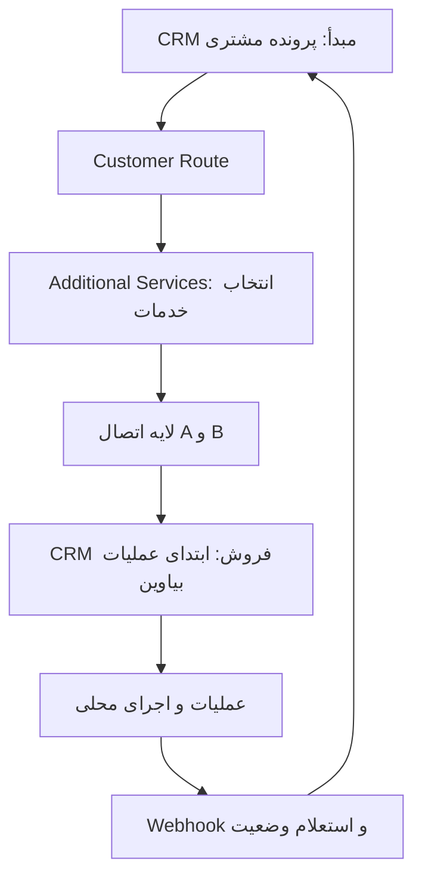
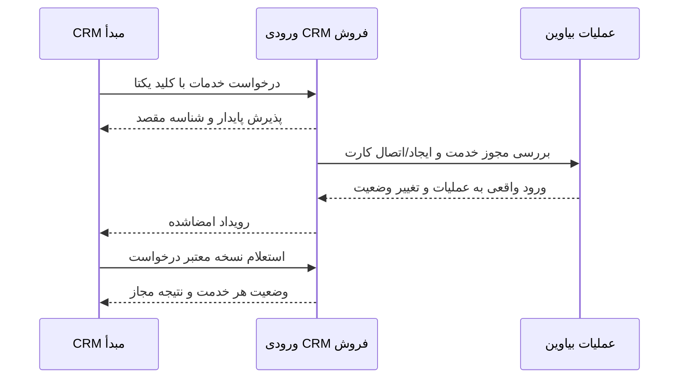
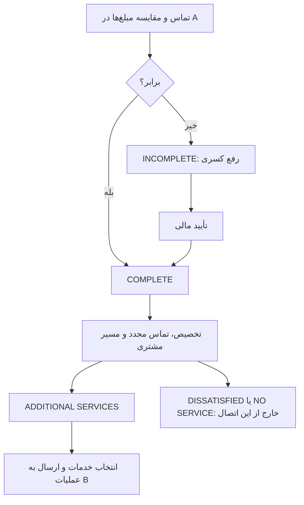
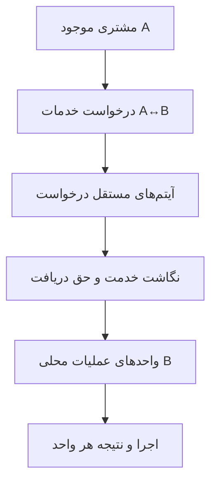

# اتصال CRM مبدأ به عملیات بیاوین و برگشت نتیجه

نسخهٔ طراحی 2.0 — جایگزین قرارداد قبلی خرید؛ طراحی اجرا نشده.

# طراحی اتصال CRM مبدأ به عملیات CRM فروش بیاوین — بازنگری ۲

تاریخ: ۲۰۲۶-۱۰-۰۲. مبنای کد مقصد: Sales Network نسخهٔ 2.0.115 موجود در این گفتگو.

این بسته جایگزین **جهت و دامنهٔ قرارداد پیشنهادی** بستهٔ قبلی `biavin-api-design` است. تحلیل کد چرخهٔ محلی در سند قبلی همچنان منبع کمکی است؛ اما قرارداد خرید و OpenAPI قبلی قرارداد این اتصال محسوب نمی‌شوند.

## تصمیم تثبیت‌شده

CRM دیگر، اطلاعات مشتری و درخواست یک یا چند خدمت را به **CRM فروش شما** می‌فرستد. CRM فروش درخواست را در **ابتدای عملیات بیاوین** وارد می‌کند، مسیر محلی عملیات و اجرا را طی می‌کند و وضعیت و نتیجه به CRM مبدأ برمی‌گردد. ارتباط دوطرفه است؛ مقصد اجرای خدمت، CRM فروش شماست. تماس احتمالی CRM فروش با ارائه‌دهندهٔ کیف پول، یک اتصال پایین‌دستی مستقل است.

## وضعیت سند

طراحی قابل بررسی است، نه قرارداد نهایی قابل استقرار. رفتار موجود کد، توضیح کاربر، پیشنهاد فنی و تصمیم‌های باز صریحاً از هم تفکیک شده‌اند. هیچ افزونه، جدول، migration، endpoint یا کد اجرایی ایجاد یا تغییر نکرده است. نام فیلدها و مسیرهای پیشنهادی در این بسته، ادعای وجود آن‌ها در CRM دیگر نیستند.

## ترتیب مطالعه

1. [معماری](INTEGRATION-ARCHITECTURE.md)
2. [چرخهٔ کسب‌وکار](01-INTEGRATION-BUSINESS-FLOW.md)
3. [مدل دامنه](02-INTEGRATION-DOMAIN-MODEL.md)
4. [قرارداد پیشنهادی](03-API-CONTRACT.md)
5. [احراز هویت و امنیت](04-AUTHENTICATION-AND-SECURITY.md)
6. [نگاشت وضعیت](05-STATUS-MAPPING.md)
7. [خطاها](06-ERROR-CATALOG.md)
8. [Webhook](07-WEBHOOK-CONTRACT.md)
9. [تکرار، timeout و retry](08-IDEMPOTENCY-AND-RETRY.md)
10. [نگاشت داده و Audit](09-INTEGRATION-DATA-MAPPING.md)
11. [پرسش‌های باز](10-OPEN-QUESTIONS.md)

`BIAWIN-INTEGRATION-REVISED.md` همان سندها را به‌ترتیب در یک فایل جمع می‌کند. `source-evidence.json` شواهد کد مقصد و `validation-report.json` کنترل‌های تحویل را نگهداری می‌کنند.

مهم‌ترین تصمیم باز: درخواست خارجی چگونه حق دریافت خدمت محلی را اثبات می‌کند و به عضویت/کارت وابسته می‌شود؟ ساخت فاکتور پرداخت‌شده یا پورسانت از روی صرف ارسال درخواست، مجاز فرض نشده است. پس از تعیین این موضوع و مشخصات CRM مبدأ، قرارداد می‌تواند برای پیاده‌سازی نهایی شود. کار این مرحله در طراحی متوقف می‌شود.


---

# معماری اتصال رفت‌وبرگشتی

## نقش دو سیستم

| شناسه | سیستم | مسئولیت |
| --- | --- | --- |
| A | CRM دیگر / CRM مبدأ | مالک پروندهٔ رضایت مشتری، مسیر اصلی مشتری، انتخاب و ارسال درخواست خدمات؛ نمایش نتیجهٔ برگشتی |
| B | CRM فروش شما / بیاوین | دریافت درخواست، تطبیق مشتری و خدمت، ورود به ابتدای عملیات محلی، تخصیص و اجرا؛ مرجع نتیجهٔ اجرای محلی |
| C، در صورت استفاده | ارائه‌دهندهٔ پایین‌دستی کیف پول یا خدمت | بخشی از اجرای خدمت تحت مدیریت B؛ خارج از قرارداد اصلی A↔B |

این نام‌گذاری جای ابهام SYSTEM A و SYSTEM B در پرامپت اولیه را می‌گیرد. URL واقعی و قرارداد موجود A در دسترس نیست. قرارداد ورودی عمومی مناسب این اتصال در نسخهٔ بررسی‌شدهٔ B یافت نشد. مسیرهای این بسته **پیشنهادی و غیرفعال** هستند.

## نمای کسب‌وکار



## توالی پیشنهادی تبادل



رویدادهای بعدی و لغو نیز رفت‌وبرگشتی‌اند. نام URLها، زمان‌بندی دقیق تماس‌ها، ارسال فایل و ترتیب انتخاب مشتری در مقصد تا پاسخ به سؤال‌های باز قطعی نیست. نمودار، مسئولیت‌ها و مسیر منطقی را نشان می‌دهد؛ یک زمان‌بندی ثابت را به سیستم خارجی تحمیل نمی‌کند.

## معماری قابل اتکا — پیشنهاد فنی

در A، درخواست کاربر و قصد ارسال به‌صورت پایدار ثبت شود. در B، پیام معتبر با شناسهٔ مقصد ثبت شود و سپس worker مشترکِ دامنه آن را بررسی کند. Outbox برای انتشار تغییرات B و Inbox برای ثبت رویدادهای دریافتی A پیشنهاد می‌شود. این‌ها مفاهیم معماری‌اند؛ هیچ جدول یا migration تعریف اجرایی نشده است.

نتیجهٔ HTTP 202 فقط «ثبت پایدار برای رسیدگی» است. نتیجهٔ پذیرش، ورود واقعی به عملیات، پیشرفت اجرا و اتمام، مراحل متفاوت‌اند. نمایش موفقیت نهایی به کارشناس A با صرف 202 اشتباه است.

B منبع معتبر وضعیت عملیات و اجرای خودش است. Webhook برای اطلاع‌رسانی سریع، GET برای وضعیت معتبر و بازیابی پس از قطعی استفاده شود. ارسال دوبارهٔ یک درخواست باید همان موجودیت مقصد را برگرداند. تراکنش توزیع‌شده یا تضمین یک‌بار تحویل شبکه فرض نشده؛ اثر منطقی تکرار باید کنترل شود.

## حدود این بازنگری

ورود به ابتدای عملیات یعنی دور نزدن انتخاب مشتری، مسیر سرپرست/مدیر و کنترل حق خدمت. انتخاب خدمات در A الزاماً معادل `activation_mode` یا ارتقای کارت B نیست. اجازهٔ ثبت تصمیم مشتری توسط کارشناس A، ساخت حق خدمت خارجی و آثار مالی، تصمیم‌های باز هستند.

**توصیه:** اتصال سرویس‌محور A↔B با آیتم‌های مستقل، پردازش پایدار و همگام‌سازی ترکیبی؛ نه قرارداد عمومی واردکردن خرید با فرض پرداخت‌شده‌بودن.


---

# ۰۱ — چرخهٔ کسب‌وکار

## سطح اطمینان

- **U — توضیح کاربر:** رفتار مورد انتظار یا جریان بیان‌شده در پرامپت؛ معادل تأیید کد A نیست.
- **C — مشاهدهٔ کد:** رفتار نسخهٔ 2.0.115 افزونهٔ مقصد؛ اجرای زندهٔ سایت و تنظیمات تولید بررسی نشده است.
- **P — پیشنهاد:** طراحی فنی قابل توافق؛ endpoint یا رفتار فعال فعلی نیست.
- **Q — تصمیم باز:** از اطلاعات موجود قابل تعیین نیست؛ پیش‌فرض کسب‌وکار برای آن ساخته نشده است.

## جریان A قبل از اتصال — U

پس از تماس با مشتری، `customer_declared_amount` با `total_invoice_amount` مقایسه می‌شود. برابر بودن به COMPLETE می‌رسد؛ نابرابر بودن به INCOMPLETE، رفع کسری و تأیید مالی می‌رود. پس از COMPLETE، تخصیص سرپرست و تماس مجدد کارشناس در جریان توضیح‌داده‌شده انجام می‌شود. سه مسیر اصلی مشتری عبارت‌اند از DISSATISFIED، ADDITIONAL SERVICES و NO SERVICE. این اتصال فقط ADDITIONAL SERVICES را پوشش می‌دهد.



تلرانس مقایسهٔ مبلغ، واحد پول، مسئول تأیید، معنای دقیق COMPLETE و نام فیلدهای واقعی A نامعلوم‌اند. این سند آن‌ها را از CRM فروش یا از نام انگلیسی پرامپت حدس نمی‌زند.

**تفکیک:** خدمات افزایشی مسیر اصلی مشتری در A است؛ تهاترِ نتیجهٔ شکایت، بازپرداخت، خزانه و رفع کسری مسیرهای متفاوت‌اند. استفادهٔ احتمالی از یک کاتالوگ مشترک، مجوز یکسان‌کردن علت درخواست و صلاحیت مشتری نیست. ارتقای کارت در B نیز به‌تنهایی معادل مسیر ADDITIONAL SERVICES در A نیست.

## جریان اتصال — U و P

| مرحله | انجام‌دهنده | اثر مورد انتظار |
| --- | --- | --- |
| بررسی COMPLETE و مسیر مشتری | A | مجازبودن ایجاد درخواست خدمات بر اساس جریان A |
| انتخاب یک یا چند خدمت | کارشناس مجاز A | یک درخواست با چند آیتم؛ نه یک مشتری مساوی یک خدمت |
| ثبت قصد ارسال و کلید یکتا | لایهٔ اتصال A | شناسهٔ پایدار قبل از اولین ارسال |
| دریافت و کنترل قرارداد | B | احراز هویت، مالکیت، تکرار، اعتبار داده و نگاشت |
| بررسی مجوز ورود به عملیات | B | پیوند به حق خدمت معتبر؛ راه اثبات آن Q است |
| ایجاد/اتصال منابع محلی | B | مشتری محلی، عضویت/کارت معتبر و عملیات؛ بدون جعل پرداخت |
| عملیات و تخصیص | B | ورود از ابتدا با قواعد محلی و صف‌های مجاز |
| اجرا | B | کیف پول، کالا یا فرم مطابق نوع محلی خدمت |
| برگشت وضعیت و نتیجه | B→A | رویداد و استعلام با شناسهٔ درخواست و آیتم |
| ثبت در سابقهٔ مشتری | A | نگهداری شناسه‌های مقصد و تاریخچه بدون بازنویسی هویت مشتری |

## رفتار محلی B — C

در مسیر عادی موجود، تأیید **تسویهٔ کامل فاکتور محلی** به ایجاد عضویت و کارت در `SN_Projects` می‌رسد. رویداد `sn_project_membership_activated`، `SN_Operations_Flow::seed_membership_cards` را اجرا می‌کند. عملیات بر مبنای `membership_item_id` ساخته می‌شود؛ معمولاً ابتدا `awaiting_customer` است. تنظیم ممنوعیت فعال‌سازی مشتری یا مهلت صفر می‌تواند بلافاصله آن را به پیگیری عملیات فروش ببرد. بنابراین «اول چرخه» الزاماً یک مقدار stage ثابت برای همهٔ خدمات نیست. [C02، C04]

کارت به مشتری، محصول محتوا، اعتبار، انتخاب‌ها و مسیر مدیران وابسته است. ایجاد عملیات خام بدون این روابط، ورود معادل مسیر فعلی نیست. صرف ساخت سفارش WooCommerce یا اعلام `paid=true` نیز ورود معتبر را تضمین نمی‌کند. [C01–C04]

در عملیات، تصمیم مشتری ممکن است درخواست کارشناس، استفادهٔ عادی یا ارتقای مجاز باشد. ارجاع فروش به مدیر/سرپرست/کارشناس و ارجاع اجرا به مدیر اجرایی/کارشناس اجرایی مسیرهای مستقل دارند. پروندهٔ اجرا با نوع محصول اصلی ساخته می‌شود. ارتقای اعتبار، نوع اجرای محصول را الزاماً عوض نمی‌کند. [C04–C06]

کیف پول ممکن است کد آماده بدهد یا از مسیر شارژ سرویس عبور کند؛ پاسخ مبهم سرویس، نیازمند استعلام است. کالا نیازمند رسیدگی به آدرس، ارسال و تحویل است. ثبت فرم با اجرای نهایی آن یکی نیست. نتیجهٔ این شاخه‌ها نباید به‌اشتباه از یک stage کلی «موفق» استخراج شود. [C05، C06، C10، C11]

## شکاف ورود خارجی — Q

دو راه برای بررسی وجود دارد؛ هیچ‌کدام بدون تصمیم کسب‌وکار فعال فرض نشده‌اند:

| راه | معنی | شرط لازم |
| --- | --- | --- |
| اتصال به حق خدمت موجود | درخواست A به عضویت/کارت معتبر B وصل شود | تطبیق مالکیت مشتری، خدمت و ظرفیت استفاده؛ جلوگیری از استفادهٔ مجدد |
| پذیرش حق خدمت خارجی | A مجوز معتبر دریافت خدمت را معرفی کند و B از مسیر دامنه منابع لازم را بسازد | تعریف مرجع مالی و مجوز، اعتبار، مالک فروش، آثار پورسانت و نحوهٔ ایجاد عضویت بدون جعل فاکتور |

اگر طبق تصمیم آینده خرید محلی لازم باشد، آن خرید باید از مسیر مالی واقعی B تأیید شود. COMPLETE در A به‌خودی‌خود به معنی پرداخت محلی B نیست. تا رفع این ابهام، درخواست می‌تواند برای بررسی پایدار پذیرفته شود، اما نباید به‌عنوان واردشده به عملیات یا خدمت انجام‌شده گزارش شود. وضعیت فنی `NEEDS_REVIEW` در این بسته، پیشنهاد لایهٔ اتصال است و stage فعلی افزونه نیست.

## صلاحیت و رسیدگی جزئی

A مسئول ارزیابی جریان COMPLETE و ADDITIONAL SERVICES خودش است. B مسئول حق خدمت محلی، مالکیت، خدمت فعال و مسیر اجرایی معتبر است. آیا B گواهی A را معتبر می‌داند یا تأیید جداگانه می‌خواهد؟ Q01 و Q08 پاسخ می‌دهند.

پذیرش بخشی از آیتم‌ها در یک درخواست چندخدمتی، رفتار قطعی نشده است. پیشنهاد فنی: اعتبارسنجی ساختاری کل پیام یکجا؛ پس از ثبت پایدار، نتیجهٔ هر آیتم مستقل و روشن. رد یک آیتم نباید بی‌اطلاع کل درخواست را موفق یا همهٔ خدمات را لغو کند. سیاست وابستگی خدمات، بسته و قیمت هنوز Q است.

## معیار صحت ورود

«وارد عملیات شد» فقط وقتی گزارش شود که هر واحد اجرایی مورد انتظار، کارت/منبع معتبر و عملیات محلی قابل ردیابی داشته باشد و مرحلهٔ شروع مطابق تنظیم مقصد تعیین شده باشد. شناسهٔ فاکتور یا پاسخ HTTP به‌تنهایی کافی نیست. نقص بین ساخت منابع باید قابل ترمیم باشد، بدون دوباره‌پرداخت یا تولید کارت و پورسانت اضافی.


---

# ۰۲ — مدل دامنهٔ اتصال

مدل زیر قرارداد مفهومی پیشنهادی است، نه طرح جدول و نه ادعای نام ستون‌های A. مدل هویت مشتری موجود در هر CRM حفظ می‌شود.

## موجودیت‌ها و شناسه‌ها

| مفهوم | مالک | هویت و مسئولیت |
| --- | --- | --- |
| مشتری CRM مبدأ | A | `crm_customer_id`: همان شناسهٔ موجود A؛ رشتهٔ opaque، بدون ساخت هویت جایگزین |
| مشتری CRM فروش | B | `sales_crm_customer_id`: شناسهٔ معتبر محلی B؛ مدل واقعی مشتری باید در پیاده‌سازی تثبیت شود |
| نگاشت مشتری | اتصال | رابطهٔ شناسهٔ مشتری A با مشتری B در محدودهٔ هویت سیستم مبدأ |
| خدمت کاتالوگ | مرجع قابل توافق | `crm_service_id` در A و شناسه/کد متناظر B؛ شناسه‌های هم‌عدد به معنی یک خدمت نیستند |
| درخواست خدمات | A و B | یک مشتری، یک `crm_service_request_id` در A، یک `external_request_id` در B از دید A |
| آیتم درخواست | A و B | `crm_service_request_item_id` پایدار A و `external_item_id` صادرشدهٔ B؛ خدمت، وضعیت و نتیجهٔ مستقل |
| واحد اجرایی | B | کارت و عملیات/پروندهٔ محلی؛ رابطه با آیتم می‌تواند یک‌به‌چند باشد |
| رویداد | B | `event_id` یکتا، نسخهٔ منبع و توالی در درخواست برای همگام‌سازی |
| تلاش انتقال | هر فرستنده | `integration_request_id` جدید برای هر تلاش؛ جدا از شناسهٔ منطقی درخواست |
| درخواست لغو | A و B | فرمان مستقل، قابل پیگیری؛ پذیرش فرمان مساوی لغو نهایی نیست |

از دید A، B سیستم خارجی است؛ بنابراین `external_customer_id`، در صورت ارائهٔ شناسهٔ محلی B، **نام قراردادی همان نگاشت** است. آن را به‌عنوان مشتری سوم یا شناسهٔ مستقل دوباره تولید نکنید. از دید B نیز مشتری A خارجی است؛ استفادهٔ بی‌توضیح از واژهٔ external در منطق داخلی ممنوع پیشنهاد می‌شود. نام‌های source و destination برای کد داخلی آینده مناسب‌ترند.

## رابطه‌ها



یک مشتری می‌تواند چند درخواست در زمان‌های مختلف داشته باشد. یک درخواست می‌تواند چند آیتم داشته باشد. یک آیتم خدمت ممکن است به یک کارت یا چند کارت یک بسته نگاشت شود. تعداد کارت‌های مورد انتظار باید از نگاشت معتبر استخراج شود، نه از حدس «هر خدمت یک کارت». هر واحد مورد انتظار باید در نتیجهٔ آیتم قابل پیگیری باشد.

برای درخواست چندخدمتی، هیچ محدودیت یک فاکتور/یک محصول به قرارداد عمومی تحمیل نشده است. محدودیت مسیر مالی فعلی B با نگاشت یا تصمیم ورود حل می‌شود. تبدیل چند آیتم به چند خرید، بدون تصمیم مالی، پیشنهاد قطعی نیست.

## داده‌های آیتم

پیشنهاد حداقل: شناسهٔ آیتم A، شناسهٔ خدمت A، مرجع نگاشت توافق‌شدهٔ خدمت B، وضعیت آیتم B و زمان تغییر. تعداد، پارامترهای خدمت، قیمت، اعتبار، مدارک و اطلاعات شخصی فقط بعد از شناخت نوع خدمت و قرارداد A تعریف شوند. فیلد عمومی `metadata` برای دورزدن این تصمیم‌ها معرفی نشده است.

اگر یک خدمت چند بار درخواست شود، باید آیتم‌های مستقل یا quantity با معنای صریح و واحدهای قابل ردیابی داشته باشد. پشتیبانی واقعی B از تکرار یک محصول روی یک فاکتور محدود است؛ quantity خارجی نباید مستقیماً به آن مسیر تحمیل شود. Q12 دربارهٔ واحد خدمت و تکرار تصمیم می‌گیرد.

## مالکیت کاتالوگ

| بُعد | آنچه معلوم است | تصمیم مورد نیاز |
| --- | --- | --- |
| هویت خدمت قابل انتخاب | A کاتالوگ دارد؛ B محصولات اشتراک/محتوا دارد | مرجع کد و شناسهٔ مشترک و نوع نگاشت، Q09 |
| نام نمایشی | هر سیستم ممکن است نام خود را داشته باشد | نام مرجع و سیاست نمایش Snapshot، Q09 |
| فعال/غیرفعال | B تنظیم محلی دارد؛ A نامعلوم | آیا نمایش A از B به‌روز شود؟ Q10 |
| availability | فعال بودن با ظرفیت/آمادگی برابر نیست | منبع و معنی ظرفیت، Q10 |
| قیمت | B قیمت خرید و هزینهٔ ارتقا دارد؛ قیمت خدمت خارجی نامعلوم | مرجع قیمت و الزام پذیرش quote، Q11 |
| اعتبار کارت | B اعتبار پایه و جاری دارد | قیمت خدمت با اعتبار کارت یکی فرض نشود؛ Q08 و Q11 |
| وضعیت اجرا | B عملیات و اجرا را مدیریت می‌کند | مرجع معتبر B؛ تعریف اتمام هر نوع خدمت هنوز نیازمند توافق است |

کاتالوگ کامل تکثیر نشود. پیشنهاد: نگاشت محدود خدمات قابل ارائه به هر مشتری اتصال، با نسخه و وضعیت آخرین همگام‌سازی. GET کاتالوگ پیشنهادی فقط نمای خدمات مجاز همین اتصال است. قیمت یا availability ناشناخته باید «نامعلوم» باشد؛ صفر و true پیش‌فرض نامعتبرند.

## هویت و تطبیق

کلید پایدار مشتری، ترکیب «سیستم A احرازشده + crm_customer_id موجود» است. موبایل فقط برای جست‌وجوی اولیه و بررسی تطبیق، با مجوز، کاربرد دارد. تغییر موبایل نباید مشتری جدید بسازد. چند تطبیق، مشتری با هویت متناقض یا نگاشت متعلق به مشتری دیگر، نیازمند رسیدگی است. B نباید تنها با موبایل یا با مساوی‌بودن اعداد شناسه، مالکیت کارت را بپذیرد.

`crm_service_request_id` در A پیش از اولین ارسال صادر شود. B شناسهٔ درخواست خودش را صادر کند و همهٔ آیتم‌ها را زیر آن نگهداری کند. راه عمومی برای شناسهٔ درخواست موجود A اگر چنین موجودیتی هنوز ندارد، Q06 است؛ این سند مدل مشتری جدیدی ایجاد نمی‌کند.


---

# ۰۳ — قرارداد پیشنهادی API

## وضعیت و دامنه

این یک قرارداد **پیش‌نویس رابط اتصال** است؛ schema سیستم A و endpoint فعال B نیست. هدف، درخواست خدمات به B و برگشت نتیجه به A است. قرارداد خرید قبلی، برای این اتصال جایگزین شده است. URL واقعی، مسیر نهایی و نام فیلدهای Adapter پس از دریافت مستندات A تثبیت شوند.

پیشنهاد حمل: REST روی HTTPS با JSON UTF-8. پیشوند نمونهٔ نسبی B: `/wp-json/sn-biavin-integration/v1`؛ وجود آن در افزونه فرض نشده است. زمان‌های تبادل، ISO 8601 با timezone؛ زمان خرید یا رویداد تاریخی از زمان ثبت محلی جدا. تاریخ‌های تقویم فرم باید قرارداد نوع خدمت داشته باشند؛ فرم‌های محلی فعلی می‌توانند تاریخ جلالی بخواهند.

## مسیرهای پیشنهادی

| دریافت‌کننده | روش و مسیر نسبی | فرستنده و کاربرد | پاسخ |
| --- | --- | --- | --- |
| B | GET `/service-catalog` | A: خدمات مجاز و نگاشت قابل انتشار | 200؛ revision و unknownهای صریح |
| B | POST `/service-requests/validate` | A: کنترل اولیهٔ ساختار، نگاشت و eligibility قابل بررسی | 200/422؛ بدون رزرو یا تغییر |
| B | POST `/service-requests` | A: ثبت درخواست با چند آیتم | 202 پس از ثبت پایدار؛ Location |
| B | GET `/service-requests?crm_service_request_id=…` | A: بازیابی پس از timeout با هویت مبدأ احرازشده | 200؛ یک نتیجه یا فهرست خالی |
| B | GET `/service-requests/{external_request_id}` | A: وضعیت معتبر و نتیجهٔ مجاز | 200؛ نسخه و وضعیت آیتم‌ها |
| B | GET `/service-requests/{external_request_id}/history` | A: تاریخچهٔ مجاز درخواست | 200؛ صفحه‌بندی cursor |
| B | POST `/service-requests/{external_request_id}/cancellations` | A: تقاضای لغو کل یا آیتم‌های مشخص | 202؛ cancellation_id، نه لغو قطعی |
| B | GET `/integration-events?cursor=…` | A: جبران رویداد ازدست‌رفته | 200؛ فقط دادهٔ همین اتصال |
| A | POST «مسیر Webhook توافق‌شده» | B: خبر تغییر درخواست/آیتم/لغو | 2xx پس از دریافت پایدار معتبر |

هیچ endpoint عمومیِ تعیین `completed`، تغییر مستقیم stage، آپلود اسناد یا ثبت پرداخت از این قرارداد نتیجه گرفته نمی‌شود. اگر A باید بعداً اطلاعات تکمیلی بفرستد، فرمان یا PATCH محدود با کنترل نسخه به قرارداد افزوده شود؛ دامنهٔ قابل تغییر هنوز Q13 است.

## Headerها — P

| نام | نقش |
| --- | --- |
| `Content-Type: application/json` | بدنهٔ JSON فرمان‌ها |
| `Accept: application/json` | پاسخ عادی؛ خطا application/problem+json |
| `Idempotency-Key` | فرمان‌های تغییردهنده؛ ثابت در retry یک فرمان |
| `X-Integration-Request-ID` | شناسهٔ هر تلاش برای Audit؛ جدید در هر retry |
| `Signature-Input`, `Signature`, `Content-Digest` | پروفایل امنیت پیشنهادی سند ۰۴؛ برای پیام دارای بدنه |
| `Location` | آدرس نسبی استعلام درخواست یا لغو پذیرفته‌شده |
| `ETag` | پیشنهاد نسخهٔ منبع در GET؛ کنترل و جلوگیری از بازنویسی قدیمی |

هویت tenant/client از credential به دست می‌آید؛ ارسال `client_id` دلخواه در بدنه مجوز ایجاد نمی‌کند. شناسهٔ تلاش سمت کلاینت نیز احراز هویت نیست.

## بدنهٔ حداقلی پیشنهادی ایجاد درخواست

تمام نام‌های نمونه زیر، نام رابط پیشنهادی‌اند؛ از فیلدهای مستند A استخراج نشده‌اند. شناسه‌ها و مقادیر ساختگی هستند. Adapter A باید نام‌های واقعی را به این رابط نگاشت کند.

```json
{
  "crm_service_request_id": "A-REQ-1048",
  "crm_customer_id": "A-CUSTOMER-718",
  "customer_route": "ADDITIONAL_SERVICES",
  "eligibility_context": {
    "declared_status": "COMPLETE"
  },
  "items": [
    {
      "crm_service_request_item_id": "A-ITEM-1",
      "crm_service_id": "A-SERVICE-17"
    },
    {
      "crm_service_request_item_id": "A-ITEM-2",
      "crm_service_id": "A-SERVICE-24"
    }
  ]
}
```

این پیام، **گواهی پرداخت یا مجوز قطعی عملیات نیست**. `declared_status` صرفاً ادعای A است تا روش معتبر اثبات eligibility توافق شود. مبلغ‌های پروندهٔ A، اطلاعات هویتی، قیمت، شماره ملی، آدرس و پیوست به‌صورت خودکار در این رابط الزامی نشده‌اند. دادهٔ مورد نیاز برای تطبیق و اجرا باید حداقل و خدمت‌محور تعریف شود. نمونهٔ حداقلی برای توضیح قرارداد است؛ تا Q01، Q07 و Q08 حل نشوند، تضمین ورود آن به عملیات وجود ندارد.

## تعریف فیلدها

| فیلد | نوع پیشنهادی | قرارداد |
| --- | --- | --- |
| crm_service_request_id | string غیرخالی | موجودیت منطقی A؛ ثابت، یکتا در محدودهٔ A |
| crm_customer_id | string غیرخالی | هویت موجود A؛ تغییر مشتری روی همان درخواست ممنوع |
| customer_route | string | در این نسخه ADDITIONAL_SERVICES؛ از مسیر تهاتر استفاده نشود |
| eligibility_context.declared_status | string | COMPLETE طبق پرامپت؛ اعتبار این ادعا نیازمند توافق |
| items | array غیرخالی | حداقل یک آیتم؛ سقف پیام/آیتم باید توافق شود |
| crm_service_request_item_id | string غیرخالی | یکتا در همان درخواست؛ ثابت برای تاریخچه |
| crm_service_id | string غیرخالی | نگاشت ثبت‌شدهٔ خدمت A به B؛ نام خدمت جای شناسه را نگیرد |

برای جلوگیری از دو مرجع متناقض، `crm_service_id` از نگاشت سروری B به خدمت مقصد تبدیل شود. اگر استفاده از `external_service_id` در پیام لازم شد، سازگاری آن با نگاشت کنترل شود. شناسهٔ مقصد از روی ورودی آزاد یا نام، بدون نگاشت معتبر، انتخاب نشود. انتخاب سیاست نهایی با Q09 است.

## پاسخ پذیرش — نمونهٔ پیشنهادی

```json
{
  "crm_service_request_id": "A-REQ-1048",
  "external_request_id": "B-REQ-9021",
  "status": "RECEIVED",
  "integration_state": "PENDING_VALIDATION",
  "resource_version": 1,
  "operations_entered": false,
  "items": [
    {"crm_service_request_item_id": "A-ITEM-1", "external_item_id": "B-ITEM-1"},
    {"crm_service_request_item_id": "A-ITEM-2", "external_item_id": "B-ITEM-2"}
  ],
  "links": {"self": "/service-requests/B-REQ-9021"}
}
```

RECEIVED به معنی دریافت پایدار در B است، نه پذیرش تجاری تمام خدمات. `integration_state` و `operations_entered` پیشنهاد رابط هستند؛ ستون موجود افزونه نیستند. تکرار معتبر همان فرمان، همان شناسهٔ درخواست/آیتم و نتیجهٔ پذیرش اولیه را برگرداند؛ وضعیت تازه از GET گرفته شود. کد پاسخ retry موفق می‌تواند همان 202 اولیه بماند.

## پاسخ استعلام و نتیجه

GET شامل شناسهٔ مشتری A و شناسهٔ محلی B در صورت تطبیق، شناسه‌های دو طرف برای درخواست و آیتم، نسخه، زمان تغییر، وضعیت هر آیتم، وضعیت ورود به عملیات، مجموعهٔ واحدهای محلی مرتبط، مشکل قابل رسیدگی و نتیجهٔ مجاز خدمت باشد. نام محلی `operation_stage` و `execution_status` از وضعیت تجمیعی رابط جدا هستند.

نمونهٔ وضعیت یک آیتم پس از ورود واقعی:

```json
{
  "crm_service_request_item_id": "A-ITEM-1",
  "external_item_id": "B-ITEM-1",
  "status": "RECEIVED",
  "operations_entered": true,
  "local_units": [
    {
      "membership_item_id": "143",
      "operation_id": "501",
      "operation_stage": "awaiting_customer",
      "execution_case_id": null,
      "execution_status": null
    }
  ]
}
```

انتشار شناسه‌های داخلی B فقط برای مصرف‌کنندهٔ مجاز و در صورت نیاز؛ وجود آن‌ها مجوز دستکاری نیست. نبود execution_case در اول عملیات طبیعی است. شکل `result` هر خدمت، مدارک، وضعیت مصرف کیف پول و داده‌های لازم A هنوز معلوم نیست؛ یک schema ساختگی عمومی برای آن‌ها نهایی نشده است. لینک/مرجع سند فقط بعد از Q18 تعریف شود.

## اعتبارسنجی، قیمت و نسخه

ساختار، نوع داده، یکتایی آیتم، نگاشت خدمت، مالکیت درخواست و مشتری و مجوز مبدأ بررسی شوند. validate فقط کنترل لحظه‌ای است و رزرو ظرفیت/قیمت نمی‌کند. B هنگام پذیرش تجاری دوباره بررسی کند؛ تغییر کاتالوگ نباید بی‌اطلاع خدمت یا اعتبار دیگری بسازد. revision و quote اختیاری تنها پس از تعیین مرجع قیمت وارد قرارداد شوند.

پیشنهاد: نسخهٔ major در مسیر، `schema_version` در رویداد و `resource_version` برای ترتیب وضعیت. این سه مفهوم متفاوت‌اند. تغییرات ناسازگار مثل تغییر معنای وضعیت، هویت یا پول به نسخهٔ جدید نیاز دارد. سیاست unknown fields و enumهای جدید قبل از پیاده‌سازی تعیین شود؛ مصرف‌کننده باید وضعیت ناشناخته را نگهداری و از اقدام مالی یا اعلام اتمام خودداری کند.

## لغو

نمونهٔ مفهومی: `crm_cancellation_id`، شناسهٔ آیتم‌های هدف در صورت لغو جزئی، و علت غیرحساس. اگر آیتم‌ها مشخص نباشند، لغو کل درخواست تقاضا می‌شود. B فرمان را با کلید یکتا ثبت می‌کند و نتیجهٔ هر هدف را گزارش می‌دهد. امکان، مهلت، هزینه، نیاز به برگشت شارژ یا مرجوعی و لغو پس از اجرا باز است. عدم پشتیبانی باید صریح گزارش شود، نه CANCELLED ساختگی.

## فایل‌ها

در قرارداد پایه، تبادل JSON در نظر گرفته شده؛ فایل اجباری فرض نشده است. نیاز به فاکتور، عکس، فرم، رضایت‌نامه و خروجی اجرا Q18 و Q19 است. اگر فایل لازم شد، قرارداد جدا برای نوع/اندازه/حجم، checksum، مجوز دسترسی، نگهداری، بدافزار و لینک محدود به زمان لازم است. B نباید URL دلخواه بدنه را بدون کنترل SSRF دانلود کند. فایل مدارک، وضعیت و حق خدمت سه مفهوم مستقل‌اند.


---

# ۰۴ — احراز هویت، مجوز و امنیت

## انتخاب پیشنهادی، نه قابلیت مشاهده‌شدهٔ A

| گزینه | مزیت | محدودیت برای این اتصال |
| --- | --- | --- |
| API Key ثابت در Header | ساده و قابل ابطال | Bearer بودن، کنترل دستکاری بدنه و replay را به‌تنهایی حل نمی‌کند |
| HMAC با کلید مشترک | امضای پیام، کنترل یکپارچگی و امکان timestamp/nonce | توزیع و چرخش secret لازم است؛ هر دارندهٔ کلید مشترک توان امضا دارد |
| OAuth2 Client Credentials | توکن کوتاه‌عمر و کنترل مجوز توسط سرویس احراز هویت | نیاز به زیرساخت معتبر OAuth و پشتیبانی دو طرف؛ وجودش در A/B معلوم نیست |
| Signed Requests | چارچوب امضای اجزای پیام؛ قابل استفاده با HMAC یا کلید نامتقارن | گزینه‌ای مستقل از الگوریتم HMAC نیست؛ پروفایل امضا باید دقیق و مشترک باشد |

**پیشنهاد پایه برای این اتصال دوطرفه:** HTTPS و HTTP Message Signatures بر مبنای RFC 9421، با پروفایل محدود HMAC-SHA256 و کلید مستقل برای هر جهت و هر اتصال. API Key ID در این طرح شناسهٔ کلید است، نه secret ارسال‌شده. این انتخاب برای طراحی توصیه می‌شود؛ سازگاری کتابخانه و زیرساخت A هنوز باید تأیید شود. اگر OAuth سازمانی معتبر موجود باشد، Client Credentials می‌تواند مکانیزم هویت/مجوز شود؛ امضای Webhook همچنان جدا بماند.

OAuth2 Client Credentials برای کلاینت سروریِ قادر به حفاظت credential تعریف شده است [S01]. RFC 9421 نحوهٔ امضای اجزای پیام HTTP را تعریف می‌کند [S02]. استفاده از HMAC به معنی موجودبودن endpoint احراز هویت یا middleware آماده در افزونه نیست.

WordPress Application Password گزینهٔ بومی برای API وردپرس است [S04]؛ اما قابلیت‌های کاربر و کنترل مالکیت باید جدا اعمال شوند. چون این اتصال دوطرفه است و وضعیت احراز هویت A معلوم نیست، قرارداد نهایی را به این روش وابسته نکرده‌ایم. دسترسی administrator برای سرویس اتصال توصیه نمی‌شود.

## پروفایل امضا — P

RFC 9421 به‌صورت استاندارد اجرا شود؛ canonicalization سفارشی به نام RFC معرفی نشود. پروفایل پیشنهادی:

| بخش | پیشنهاد |
| --- | --- |
| الگوریتم | `hmac-sha256` با secret تصادفی اختصاصی؛ حداقل ۳۲ بایت پیشنهاد فنی |
| شناسه | `keyid` نگاشت‌شده به سیستم/اتصال/جهت؛ الگوریتم از پیکربندی معتبر کنترل شود |
| پارامترها | `created`، `expires`، `nonce`، `keyid`، `alg` و `tag` اختصاصی نسخهٔ این اتصال |
| اجزای همهٔ درخواست‌ها | `@method`، `@target-uri`، `x-integration-request-id` |
| اجزای پیام دارای بدنه | موارد بالا به‌علاوه `content-type` و `content-digest` |
| فرمان‌های تغییردهنده | `idempotency-key` نیز پوشش امضا داشته باشد |
| Webhook | `x-biavin-event-id` و بدنه نیز پوشش داده شوند |
| Content-Digest | SHA-256 مطابق RFC 9530، از بایت‌های واقعی بدنه [S03] |

پیشنهاد زمان: طول عمر امضا حداکثر ۳۰۰ ثانیه و تحمل اختلاف ساعت حداکثر ۶۰ ثانیه؛ مقادیر باید با توان ساعت/زیرساخت دو طرف توافق شوند. nonce در محدودهٔ keyid طی تمام بازهٔ اعتبار و تحمل ساعت یکتا باشد. receiver آن را اتمیک ثبت کند. در retry انتقال، امضا/nonce/زمان تازه، ولی کلید idempotency همان فرمان باقی می‌ماند.

Reverse proxy، query string، Host و URI خارجی باید در محیط تست برای امضای target-uri کنترل شوند. از Header قابل جعلِ proxy برای انتخاب URI معتبر استفاده نشود. امضای معتبر با digest متناقض، بدنهٔ تغییرکرده یا مؤلفهٔ ضروری غایب، رد شود. تا داشتن test vector مشترک، پروفایل برای استقرار نهایی آماده نیست.

## مجوز

پیشنهاد scopes: `service_catalog:read`، `service_requests:create`، `service_requests:read`، `service_requests:cancel` و `integration_events:read`. نام scopes قراردادی پیشنهادی است؛ WordPress یا A خودکار آن‌ها را نمی‌شناسد. یک service principal اختصاصی و نگاشت نقش/قابلیت در B لازم خواهد بود.

در هر GET/POST، مالکیت درخواست به اتصال احرازشده کنترل شود. شناسهٔ درخواست، مشتری، آیتم یا عملیاتِ متعلق به اتصال دیگر مجوز نمی‌دهد. ناشر A فقط در محدودهٔ خدمات و مشتریان مجاز خودش ارسال کند. اجازهٔ اتصال به کارت موجود، نشر اسناد، ثبت تصمیم مشتری یا پذیرفتن گواهی حق خدمت، مجوزهای مستقل و تصمیم‌های باز هستند.

## محافظت و دادهٔ شخصی

- secret، token، امضا و اطلاعات مشتری از لاگ عمومی حذف شوند؛ secret در URL یا فایل خروجی گزارش قرار نگیرد.
- موبایل، کد ملی و سایر اطلاعات شخصی secret نیستند؛ هیچ‌کدام کلید API نشوند.
- کلید هر جهت مستقل، قابل ابطال و دارای برنامهٔ چرخش با دورهٔ هم‌پوشانی محدود باشد؛ credential مشتریان اتصال مشترک نشود.
- دادهٔ شخصی فقط برای تطبیق و اجرای ضروری، با حداقل دسترسی، مدت نگهداری و رمزنگاری مناسب محل ذخیره ارسال شود؛ جزئیات سیاست حفظ داده Q20 است.
- TLS اعتبارسنجی شود؛ redirect خودکار روی درخواست امضاشده و credentialدار ممنوع پیشنهاد می‌شود. callback فقط مقصد ثبت‌شدهٔ اتصال باشد.
- اندازهٔ بدنه، تعداد آیتم، نرخ درخواست و حجم فایل محدود و توافق شود. سقف‌ها در این نسخه قانون فعال محسوب نمی‌شوند.
- خطای مجوز نباید وجود پروندهٔ متعلق به مشتری دیگر را افشا کند؛ پاسخ ظاهری 404 یا 403 بر اساس سیاست مشترک تعیین شود.
- نتیجهٔ کیف پول، کد فعال‌سازی و اسناد حساس در Webhook عمومی منتشر نشوند؛ دریافت آن‌ها مسیر مجاز جدا لازم دارد.

## منابع استاندارد

- S01 — [RFC 6749، بخش 4.4](https://www.rfc-editor.org/rfc/rfc6749.html#section-4.4).
- S02 — [RFC 9421، HTTP Message Signatures](https://www.rfc-editor.org/rfc/rfc9421.html).
- S03 — [RFC 9530، Digest Fields](https://www.rfc-editor.org/rfc/rfc9530.html).
- S04 — [WordPress Application Passwords](https://developer.wordpress.org/advanced-administration/security/application-passwords/).

این منابع پروتکل فنی را پشتیبانی می‌کنند؛ قواعد صلاحیت مشتری و مجوز خدمت از آن‌ها استخراج نشده است.


---

# ۰۵ — چرخه و نگاشت وضعیت

تمام نام‌های بزرگ این سند **واژگان پیشنهادی اتصال** هستند. وضعیت‌های واقعی A هنوز معلوم نیست؛ وضعیت‌های محلی B در جدول نگاشت مشخص‌اند. enum نهایی تا تعیین معنای اتمام خدمات و دریافت مستندات A تثبیت نمی‌شود.

## سه سطح مستقل

| سطح | مثال | مرجع |
| --- | --- | --- |
| صلاحیت مشتری | COMPLETE و ADDITIONAL_SERVICES | A؛ مطابق پرامپت، نه نتیجهٔ اجرای B |
| رسیدگی اتصال | PENDING_VALIDATION، NEEDS_REVIEW، RETRYING، SYNC_STALE | لایهٔ اتصال؛ وضعیت کسب‌وکار خدمت را عوض نمی‌کند |
| خدمت/درخواست | RECEIVED، IN_PROGRESS، COMPLETED و وضعیت‌های زیر | B برای اجرا؛ A برای پیش‌نویس و ارسال |

timeout انتقال یا Webhook ناموفق نباید خدمت را FAILED کند. CUSTOMER COMPLETE به معنی SERVICE COMPLETED نیست. عملیاتِ پذیرفته‌شده نیز با خدمت انجام‌شده یکی نیست.

## چرخهٔ پیشنهادی درخواست و آیتم

| وضعیت | معنی | مالک انتقال |
| --- | --- | --- |
| DRAFT | درخواست قابل ویرایش، هنوز ارسال نشده | A |
| SUBMITTED | قصد ارسال پایدار؛ نتیجهٔ دریافت مقصد ممکن است نامعلوم باشد | A |
| RECEIVED | B پیام را پایدار ثبت کرده؛ پذیرش تجاری ممکن است در بررسی باشد | B |
| IN_PROGRESS | رسیدگی/عملیات واقعی حداقل یک واحد شروع شده | B بر اساس وضعیت معتبر محلی |
| PARTIALLY_COMPLETED | حداقل بخشی انجام شده، ولی همهٔ تعهدات تکمیل نشده‌اند | B؛ قاعدهٔ تجمیع پیشنهادی زیر |
| COMPLETED | همهٔ تعهدات آیتم یا درخواست طبق معیار توافق‌شده انجام شده‌اند | B |
| REJECTED | خدمت پیش از اجرای تعهد به دلیل تجاری پذیرفته نشده | B؛ علت لازم |
| CANCELLED | لغو واقعی تأییدشده؛ صرف تقاضای لغو کافی نیست | B؛ پس از رسیدگی به فرمان A |
| FAILED | اجرای تعهد شکست قطعی دارد؛ خطای انتقال نیست | B؛ معیار قطعی شکست و بازیابی Q14 |

درخواست A و نسخهٔ B می‌توانند هم‌زمان وضعیت‌های محلی متفاوتی داشته باشند؛ مثلاً A در SUBMITTED و B در RECEIVED باشد. A پس از همگام‌سازی تصویر B را دریافت می‌کند، بدون پاک‌کردن تاریخچهٔ ارسال.

پیشنهاد انتقال‌های اصلی: DRAFT→SUBMITTED در A؛ ثبت B→RECEIVED؛ سپس RECEIVED→IN_PROGRESS/REJECTED/CANCELLED؛ IN_PROGRESS→PARTIALLY_COMPLETED/COMPLETED/FAILED/CANCELLED؛ PARTIALLY_COMPLETED→COMPLETED یا وضعیت پایانی ترکیبی. A اجازهٔ مستقیم COMPLETED کردن B ندارد. تغییر آیتم پایانی به باز یا اجرای دوباره، نیازمند فرمان و قانون صریح است و در این نسخه تعریف نشده است.

## قاعدهٔ پیشنهادی تجمیع

برای جلوگیری از پنهان‌شدن وضعیت جزئی، در سطح درخواست علاوه بر status، `item_counts` و `is_terminal` پیشنهاد می‌شود. terminal یعنی این دور رسیدگی پایان یافته؛ به معنی موفقیت کامل نیست.

| ترکیب آیتم‌ها | پیشنهاد وضعیت درخواست | terminal |
| --- | --- | --- |
| همه COMPLETED | COMPLETED | true |
| بعضی COMPLETED و حداقل یک غیرکامل | PARTIALLY_COMPLETED | فقط اگر همهٔ آیتم‌ها پایانی‌اند |
| همه REJECTED | REJECTED | true |
| همه CANCELLED | CANCELLED | true |
| هیچ تکمیل نشده؛ همه در REJECTED/CANCELLED/FAILED و ترکیبی‌اند | FAILED با outcome ترکیبی و جزئیات آیتم‌ها | true |
| هیچ تکمیل نشده؛ حداقل یک IN_PROGRESS | IN_PROGRESS | false |
| همه دریافت‌شده و هنوز شروع نشده‌اند | RECEIVED | false |

این ترتیب اولویت **پیشنهاد فنی برای قرارداد** است، نه قانون موجود کسب‌وکار. تأیید اینکه ترکیب rejected/cancelled باید FAILED نامیده شود یا وضعیت مستقلی داشته باشد، Q14 است. «تکمیل جزئی» یک آیتم فقط اگر واحدها یا معیار تقسیم خدمت تعریف شوند قابل اعلام است؛ درصد حدسی پیشرفت تولید نشود.

## نگاشت مشاهده‌شدهٔ B به رابط — پیش‌نویس

| وضعیت واقعی B | تفسیر قابل اتکا | پیشنهاد رابط / ابهام |
| --- | --- | --- |
| `awaiting_customer` | عملیات موجود، منتظر تصمیم مشتری | RECEIVED؛ operations_entered=true؛ reason=awaiting_customer |
| `sales_manager_queue`, `sales_supervisor`, `sales_expert` | پیگیری عملیات فروش | IN_PROGRESS؛ completion نیست |
| `upgrade_payment` | انتظار پرداخت ارتقای کارت | IN_PROGRESS؛ نیاز مالی محلی، بدون مطالبهٔ خودکار از A |
| `executive_manager_queue` | آمادهٔ تخصیص اجرایی | IN_PROGRESS |
| `execution_expert`, `executive_in_progress` | رسیدگی کارشناس اجرا | IN_PROGRESS |
| `customer_code_issued` | کد آماده به مشتری داده شده | پایان خدمت یا صرف تحویل کد؟ Q15؛ خودکار COMPLETED نشود |
| `execution_wallet_active` / case=`wallet_charged` | شارژ ثبت‌شدهٔ کیف پول | معیار اتمام شارژ یا مصرف/فعال‌سازی؟ Q15 |
| wallet_status=`sync_pending` | نتیجهٔ مقصد شارژ روشن نیست | IN_PROGRESS + نیاز استعلام؛ FAILED قطعی نیست |
| `execution_form_review` / case=`form_completed` | دادهٔ فرم ذخیره، تصمیم نهایی باقی است | IN_PROGRESS |
| case=`completed` / تصمیم فرم executed | اجرای نهایی ثبت شده | کاندید COMPLETED برای همان واحد با تطبیق نوع خدمت |
| `shipping_queue`, `shipping_processing`, `shipped` | مسیر ارسال کالا | IN_PROGRESS؛ shipped مساوی delivered نیست |
| `delivered` | تحویل ثبت شده | کاندید COMPLETED واحد کالایی، مشروط به معیار توافق‌شده |
| `shipping_not_sent`, `shipping_returned`, `shipping_cancelled` | وضعیت منفی ارسال با علت | نگاشت FAILED/CANCELLED و اثر مرجوعی Q16؛ حدس نشود |
| `execution_not_executed` / case=`not_executed` | عدم اجرا با علت | FAILED یا REJECTED طبق زمان و علت؛ Q14 |
| `execution_cancelled`, `cancelled` | انصراف محلی | کاندید CANCELLED؛ شرایط جبران و اعلان Q16 |
| `completed` در مسیر قدیمی عملیات | تکمیل در مسیر قدیمی | با پروندهٔ نوع‌دار و شواهد اجرا تطبیق داده شود |
| membership=`suspended` | تعلیق عضویت | جدا از service status؛ نتیجهٔ خدمات قبلاً انجام‌شده پاک نشود |

به‌دلیل چند مسیر legacy و تفاوت ثبت completion timestamp، یک ستون `stage` یا `completed_at` منبع کافی برای همهٔ انواع خدمت نیست. تطبیق باید پروندهٔ اجرا، نوع خدمت و نتیجهٔ واحد را بررسی کند. [C05، C06، C09–C11]

## ترتیب و اصلاح

B به هر تغییر منبع نسخهٔ افزایشی دهد. A نسخهٔ پایین‌تر را برای Audit نگه دارد ولی روی وضعیت جاری اعمال نکند. رویداد قدیمی/نامرتب با GET جبران شود. timestamp برای ترتیب کافی نیست. اگر B وضعیت قبلی را اصلاح کند، رویداد نسخهٔ جدید با علت اصلاح لازم است؛ پاک‌کردن history یا برگشت خودکار مالی از تغییر label نتیجه گرفته نمی‌شود.


---

# ۰۶ — مدل و فهرست خطا

## قرارداد پیشنهادی

خطاهای HTTP همزمان با `application/problem+json` مطابق RFC 9457 بیان شوند. افزونه و A لزوماً اکنون این مدل را ندارند. RFC ساختار عمومی را تعریف می‌کند؛ codeهای کسب‌وکار زیر **پیشنهادی و قابل تغییر پس از شناخت A** هستند.

```json
{
  "type": "about:blank",
  "title": "Request conflict",
  "status": 409,
  "detail": "The same idempotency key was used with a different payload.",
  "code": "IDEMPOTENCY_CONFLICT",
  "category": "IDEMPOTENCY",
  "retryable": false,
  "integration_request_id": "TRY-003",
  "field_errors": []
}
```

code پایدار برای ماشین، message/detail قابل نمایش بدون دادهٔ حساس، field_errors برای فیلد و آیتم، retryable برای خطای همین عملیات پیشنهاد می‌شود. خطاهای پس از 202 در وضعیت رسیدگی/آیتم گزارش شوند؛ HTTP موفق GET با نتیجهٔ خدمت ناموفق تناقض نیست. معنای status عددی داخل Problem با service status متفاوت است.

## دسته‌بندی اولیه

| دسته | code پیشنهادی | وضعیت معمول HTTP / رفتار | اقدام مصرف‌کننده |
| --- | --- | --- | --- |
| Authentication | AUTH_FAILED | 401، credential/امضا نامعتبر | اصلاح credential؛ retry خودکار مکرر نشود |
| Authentication | SIGNATURE_EXPIRED / REPLAY_DETECTED | 401 طبق پروفایل | ساعت/nonce/امضا را اصلاح کند؛ idemkey عوض نشود |
| Authorization | ACCESS_DENIED | 403 یا 404 طبق سیاست عدم افشا | تغییر مالکیت/مجوز نیازمند بررسی |
| Validation | INVALID_REQUEST | 400 برای JSON خراب، 422 برای دادهٔ نامعتبر | اصلاح ورودی با خطای فیلد |
| Business | CUSTOMER_NOT_FOUND | 422 یا نتیجهٔ بررسی پس از 202 | تطبیق یا ایجاد مجاز مشتری؛ سیاست Q07 |
| Business | CUSTOMER_IDENTITY_CONFLICT | 409/نتیجهٔ رسیدگی | رسیدگی انسانی، بدون ادغام خودکار |
| Business | CUSTOMER_NOT_ELIGIBLE | 422/رد پس از بررسی | اصلاح جریان A یا ارائهٔ مدرک مجاز |
| Business | ENTITLEMENT_NOT_VERIFIED | نتیجهٔ NEEDS_REVIEW یا رد طبق سیاست | تعیین حق خدمت؛ پرداخت جعلی نسازد |
| Business | SERVICE_NOT_FOUND | 422 | اصلاح نگاشت |
| Business | SERVICE_INACTIVE | 422/رد آیتم | انتخاب خدمت مجاز |
| Business | SERVICE_UNAVAILABLE | 422 یا خطای آیتم | علت و زمان در صورت معلوم؛ retry فوری بدون سیاست نکند |
| Business | SERVICE_MAPPING_INCOMPLETE | 422/NEEDS_REVIEW | تکمیل نگاشت کاتالوگ |
| Business | CANCELLATION_NOT_SUPPORTED / CANCELLATION_NOT_ALLOWED | 422 یا نتیجهٔ فرمان لغو | گزارش عدم لغو؛ CANCELLED اعلام نکند |
| Idempotency | IDEMPOTENCY_CONFLICT | 409 | کلید یکسان با payload متفاوت؛ بررسی خطای کلاینت |
| Idempotency | REQUEST_ID_CONFLICT | 409 | شناسهٔ طبیعی درخواست یکسان، محتوای متفاوت |
| Idempotency | DUPLICATE_REQUEST | موفقیت replay برای محتوای یکسان؛ conflict برای متفاوت | درخواست قبلی را استعلام کند |
| Technical | RATE_LIMITED | 429 و Retry-After | رعایت زمان و همان idemkey |
| Technical | EXTERNAL_SYSTEM_ERROR | 502/503 یا وضعیت retrying worker | retry محدود/استعلام، بدون ایجاد درخواست جدید |
| Technical | TIMEOUT | ممکن است اصلاً پاسخ HTTP دریافت نشود | نتیجه نامعلوم؛ GET/ارسال همان فرمان |
| Technical | INTERNAL_ERROR / QUEUE_UNAVAILABLE | 500/503 | اگر ثبت پایدار نامعلوم، استعلام؛ بعد retry همان فرمان |
| Technical | ACTIVATION_INCOMPLETE | رسیدگی پس از دریافت | ترمیم منابع ناقص، بدون تکرار پرداخت |

کلمهٔ EXTERNAL در A به B و در worker B ممکن است به سرویس C اشاره کند؛ لاگ باید `failing_system` و مرحلهٔ شکست را در صورت مجاز روشن کند. همهٔ خطاهای B را به «خدمت ناموفق» تبدیل نکنید.

## رد، شکست و خطای انتقال

REJECTED تصمیم کسب‌وکار است؛ FAILED شکست اجرای قطعی؛ 5xx مشکل فنی انتقال/رسیدگی است. یک 404 استعلام بعد از timeout می‌تواند پیش از ثبت درخواست یا ناشی از شناسه/مجوز غلط باشد. بلافاصله سفارش تازه با کلید جدید ایجاد نشود؛ پروتکل retry سند ۰۸ دنبال شود.

برای پیام چندآیتمی، خطای ساختاری پیام می‌تواند کل ثبت را رد کند؛ خطای کسب‌وکار آیتم پس از دریافت به همان آیتم تعلق داشته باشد، مطابق سیاست پذیرش جزئیِ توافق‌شده. code و علت هر آیتم در تاریخچه باقی بماند.

متن خام بانک/سرویس کیف پول، response body حاوی secret و stack trace در خطای مصرف‌کننده منتشر نشود. با correlation ID به لاگ محدود داخلی ارجاع داده شود.

منبع: [RFC 9457 — Problem Details for HTTP APIs](https://www.rfc-editor.org/rfc/rfc9457.html). فهرست بالا فهرست نهایی سیستم خارجی نیست.


---

# ۰۷ — Webhook و همگام‌سازی وضعیت

## جهت و مالکیت

B ناشر رویدادهای معتبر اجرای محلی است؛ A گیرنده و ثبت‌کننده در سابقهٔ مشتری مبدأ. callback فقط برای URL HTTPS از پیش ثبت‌شدهٔ همان اتصال ارسال شود. URL دلخواه داخل هر درخواست خدمات، مبنای ارسال credential یا نتیجه قرار نگیرد.

ساختار زیر پیشنهاد رابط اتصال است، نه شکل فعلی callback یا دیتابیس A. نام رویدادهای واقعی افزونه باید توسط Adapter به این نام‌ها تبدیل شود.

```json
{
  "schema_version": "1.0",
  "event_id": "B-EVENT-801",
  "event_type": "service_request.item_status_changed",
  "occurred_at": "2026-10-02T15:00:00+03:30",
  "sequence": 8,
  "resource_version": 8,
  "crm_customer_id": "A-CUSTOMER-718",
  "crm_service_request_id": "A-REQ-1048",
  "external_request_id": "B-REQ-9021",
  "data": {
    "crm_service_request_item_id": "A-ITEM-1",
    "external_item_id": "B-ITEM-1",
    "status": "IN_PROGRESS",
    "operations_entered": true
  }
}
```

Event ID پایدار و یکتا در محدودهٔ ناشر احرازشده؛ در همهٔ retryها یکسان بماند. sequence برای هر درخواست، نسخهٔ منبع برای snapshot و زمان رویداد برای Audit است. پیشنهاد این نسخه: هر تغییر منتشرشدهٔ درخواست یک نسخه و sequence همسان دارد. اگر چند رویداد برای یک نسخه لازم شد، قاعدهٔ شماره‌گذاری قبل از نهایی‌سازی جدا تعریف شود.

## رویدادهای اولیه — P

- `service_request.received`: دریافت پایدار، نه اتمام ورود به عملیات.
- `service_request.operations_entered`: پس از ساخت/اتصال واقعی واحدهای عملیات مورد انتظار.
- `service_request.item_status_changed`: تغییر وضعیت یک آیتم با نسخهٔ جدید درخواست.
- `service_request.status_changed`: نتیجهٔ تجمیعی طبق قرارداد توافق‌شده.
- `service_request.cancellation_decided`: تصمیم لغو و نتیجهٔ اهداف.
- `service_request.review_required`: نقص قابل رسیدگی در اتصال/حق خدمت/نگاشت.

این نام‌ها hookهای موجود افزونه نیستند. انتشارشان نیاز به توسعهٔ بعدی دارد. Webhook کاملِ اطلاعات هویتی، کد فعال‌سازی، secret، فرم و سند حساس نباشد. برای دریافت نتیجهٔ مجاز از GET مربوط به همان درخواست استفاده شود.

## امضا و replay

پروفایل سند ۰۴ برای Webhook هم اعمال شود: `Signature-Input` و `Signature`، digest بدنه، timestampهای created/expires، nonce جدید هر تلاش و keyid مستقل B→A. Header پیشنهادی `X-Biavin-Event-ID` باید با event_id بدنه یکسان و در امضا پوشش داده شود. receiver الگوریتم و کلید را از پیکربندی معتبر خودش انتخاب کند، نه از انتخاب آزاد فرستنده.

پیشنهاد پنجرهٔ امضا ۳۰۰ ثانیه و تحمل ساعت ۶۰ ثانیه است؛ قطعی طولانی با امضای تازهٔ همان رویداد بازیابی می‌شود. dedup رویداد فقط به این پنج دقیقه محدود نباشد. replay انتقال با nonce و زمان کنترل می‌شود؛ پردازش دوبارهٔ اثر با event_id و نسخه کنترل می‌شود.

## پردازش idempotent در A

1. هویت/امضا، زمان، nonce، digest، event_id و ساختار را کنترل کند؛ دادهٔ نامعتبر قبل از تغییر پرونده رد شود.
2. رویداد معتبر را با کلید «ناشر + event_id» به‌صورت پایدار ثبت کند.
3. اگر event_id تکراری و بدنه همان باشد، 2xx بدون اثر دوباره برگرداند. event_id یکسان با محتوای متفاوت conflict امنیتی/داده‌ای است و quarantine شود.
4. بعد از ثبت پایدار، پاسخ 2xx بدهد؛ پردازش دامنه می‌تواند صفی باشد. شکست پیش از ثبت پایدار نباید 2xx ساختگی بدهد.
5. مالکیت customer/request/item را با نگاشت کنترل کند. پیام متعلق به درخواست ناشناخته یا مشتری متناقض، از مسیر تطبیق/رسیدگی عبور کند، نه ساخت مشتری از موبایل.
6. نسخهٔ قدیمی را بر وضعیت جدید ننویسد. شکاف sequence یا دادهٔ ناقص را با GET جبران کند.
7. نتیجهٔ جاری و history را در یک عملیات قابل اتکا به‌روز کند؛ اثر ناقص قابل بازیابی باشد.

هیچ تضمین ترتیب تحویل، یک‌بار تحویل یا حضور همیشهٔ A فرض نشده است. امضای معتبر تضمین ترتیب تجاری نیست.

## Polling و معماری ترکیبی

| روش | کاربرد | محدودیت |
| --- | --- | --- |
| Polling A→B | استعلام وضعیت جاری، بازیابی timeout و شکاف رویداد | تأخیر و بار؛ نرخ باید توافق شود |
| Webhook B→A | خبر سریع تغییر | قطعی و تحویل تکراری/نامرتب ممکن است |
| ترکیبی | Webhook برای خبر؛ GET برای منبع معتبر؛ reconciliation دوره‌ای | نیاز به checkpoint، نسخه و نگهداری history |

پیشنهاد زمان‌بندی اولیه: Polling درخواست‌های باز هر ۵ دقیقه با jitter؛ پس از رویداد دارای شکاف، استعلام فوری کنترل‌شده؛ تطبیق روزانهٔ درخواست‌های اخیر. این اعداد تنظیم پیشنهادی‌اند، SLA یا رفتار موجود نیستند. درخواست terminal می‌تواند رویداد اصلاح داشته باشد؛ آخرین درخواست‌ها در بازهٔ توافق‌شده بازبینی شوند.

GET events با cursor فقط رویدادهای همان اتصال را برگرداند. cursor نامعتبر یا منقضی پاسخ روشن داشته باشد؛ A باید از snapshot درخواست‌های خودش بازسازی کند. تاریخچهٔ مورد نیاز کسب‌وکار با صف ارسال Webhook یکی نیست.

## Retry ناشر

2xx = دریافت پایدار؛ timeout و خطاهای انتقال/408/429/5xx قابل retry محدود؛ 400/401/403/422 نیازمند اصلاح، نه ارسال بی‌نهایت. 404/410 callback باید پس از تأیید تنظیم اتصال رسیدگی شود. برنامهٔ backoff سند ۰۸ مبنای پیشنهادی است. پس از سقف تلاش، dead-letter و هشدار عملیاتی؛ خدمت محلی همچنان وضعیت واقعی خودش را حفظ کند.


---

# ۰۸ — جلوگیری از تکرار، timeout و retry

## سه هویت مستقل

| هویت | تولیدکننده | رفتار در retry |
| --- | --- | --- |
| `crm_service_request_id` | A؛ قبل از ارسال | ثابت برای همان درخواست دامنه |
| `Idempotency-Key` | فرستندهٔ فرمان؛ پیش از اولین تلاش | ثابت برای همان فرمان و بدنه |
| `integration_request_id` | فرستندهٔ هر تلاش انتقال | جدید برای هر تلاش؛ ارتباط با فرمان ثابت حفظ شود |

یک UUID تصادفی امن برای idemkey مناسب پیشنهاد می‌شود؛ موبایل، timestamp تنها و نام مشتری کلید مناسبی نیستند. کلید لغو با ایجاد درخواست یکی نباشد. nonce امضا نیز با idempotency-key یکی نیست؛ retry باید nonce تازه داشته باشد.

## رفتار گیرنده — P

کلید تکرار در محدودهٔ «اتصال احرازشده + نوع فرمان + منبع هدف + idemkey» ثبت شود. فرمان create منبع هدف مشترک collection دارد؛ فرمان cancellation، شناسهٔ درخواست هدف را نیز در scope داشته باشد. بدنه پس از کنترل schema و قواعد normalization، به‌صورت deterministic hash شود. تفاوت ترتیب propertyها نباید conflict بسازد؛ ترتیب آیتم‌ها حفظ شود مگر قرارداد صریح آن را بی‌اثر بداند.

هویت‌های درخواست، مشتری و آیتم و هر دادهٔ مؤثر کسب‌وکار در hash قرار بگیرند. Header مربوط به تلاش، timestamp/nonce/امضا در hash دامنه نباشند. trim، تبدیل عدد و مقادیر پیش‌فرض بدون قرارداد نهایی انجام نشود. انتخاب روش canonical JSON و test vectorهای دو طرف پیش از پیاده‌سازی لازم است؛ صرف hash متن بدنه تضمین هم‌معنایی نیست.

| وضعیت | پاسخ لازم |
| --- | --- |
| idemkey جدید و درخواست طبیعی جدید | ثبت پایدار یک موجودیت و نتیجهٔ پذیرش |
| idemkey یکسان و hash یکسان | همان شناسه‌ها و پاسخ پذیرش ثبت‌شده؛ بدون اثر دوباره |
| idemkey یکسان و hash متفاوت | 409 IDEMPOTENCY_CONFLICT |
| idemkey متفاوت، crm_service_request_id یکسان و دادهٔ مؤثر همان | بازیابی همان درخواست، نه ایجاد دوم |
| idemkey متفاوت، شناسهٔ طبیعی یکسان و محتوای متفاوت | 409 REQUEST_ID_CONFLICT؛ فرمان اصلاح جدا لازم است |
| همان کلید هنوز در حال ثبت | انتظار محدود یا پاسخ ارجاع به منبع ثبت‌شده؛ پردازش دوم شروع نشود |

شناسهٔ طبیعی «هویت A احرازشده + crm_service_request_id» یک لایهٔ مستقل از cache idempotency است. برای آیتم، شناسهٔ درخواست + crm_service_request_item_id؛ برای رویداد، ناشر + event_id؛ برای لغو، هویت مبدأ + crm_cancellation_id پیشنهاد می‌شود.

کنترل تکرار باید اتمیک و مقاوم در برابر دو worker همزمان باشد. check-then-insert یا صرف SELECT کافی نیست. این سند migration نمی‌سازد؛ الزام consistency برای پیاده‌سازی آینده بیان شده است.

## مدت اعتبار و نگهداری

پیشنهاد اولیه: نگهداری پاسخ idemkey حداقل ۹۰ روز از اولین پذیرش و تمدید نکردن نامحدود با هر retry. این مدت باید از حداکثر offline/retry توافق‌شده بیشتر باشد. عمر کلید در A نباید با انقضای cache عوض شود. پس از ۹۰ روز، حفاظت شناسهٔ طبیعی درخواست و ارتباط دامنه همچنان لازم است.

نگهداری بلندمدت شناسه‌های حداقلی/رد تکرار با سیاست حذف داده و Audit هماهنگ شود؛ مدت قانونی یا ابدی ساخته نشده است. اگر نگاشت حذف شده و سیستم نمی‌تواند نبود درخواست قدیمی را اثبات کند، فرمان قدیمی بدون رسیدگی نباید به خدمت تازه تبدیل شود. Q20 و Q21 سیاست نهایی را تعیین می‌کنند.

## timeout و retry فرستنده

timeout به معنی ثبت‌نشدن نیست. A ابتدا با شناسهٔ طبیعی درخواست خودش از B استعلام کند؛ اگر ثبت شده، همان external_request_id را ادامه دهد. اگر نتیجه نامعلوم یا ثبت هنوز در حال انجام است، retry همان فرمان و همان idemkey انجام شود. refresh صفحه و retry کاربر باید همان درخواست پایدار را هدف بگیرند؛ هر بار UUID درخواست جدید نسازند.

پیشنهاد تنظیم اولیه: connect timeout پنج ثانیه، total timeout بیست ثانیه برای پذیرش؛ اجرای خدمت async باشد. retry با full jitter حول ۱، ۵، ۱۵، ۶۰ و ۳۶۰ دقیقه و سقف ۲۴ ساعت، سپس رسیدگی. این اعداد قانون فعلی نیستند. برای 429، Retry-After با سقف توافق‌شده رعایت شود. خطای schema یا Business Error با retry بدون تغییر حل نمی‌شود.

| رخداد | اقدام |
| --- | --- |
| پاسخ 202 | شناسه‌ها را پایدار نگه دارد؛ منتظر استعلام/رویداد باشد |
| شبکه قطع شد / پاسخ از دست رفت | GET با شناسهٔ A و سپس retry همان کلید |
| 408/429/5xx | retry محدود و استعلام؛ به نتیجهٔ اتمام تبدیل نشود |
| 401/403 | اصلاح هویت/مجوز؛ همان فرمان دوباره بررسی شود |
| 409 conflict | توقف خودکار و بررسی اختلاف payload |
| 400/422 | اصلاح ورودی؛ payload متفاوت با کلید قبلی پذیرفته نشود |
| Webhook تکراری | event_id ثابت؛ nonce تازه؛ dedup گیرنده |

## جلوگیری از اثر دوباره در B

یک درخواست پایدار به‌تنهایی مانع دو کارت یا دو شارژ نیست. worker باید نگاشت هر آیتم به واحدهای محلی، تعداد انتظار و نتیجهٔ هر فرمان پایین‌دستی را کنترل کند. ساخت ناقص کارت/عملیات باید از همان منابع ادامه یابد. تکرار hook مالی یا fake POST راه ترمیم نیست.

در کد فعلی، وجود membership ممکن است باعث عبورنکردن دوبارهٔ رویداد فعال‌سازی شود؛ مسیر مالی already-paid نیز الزاماً همهٔ آثار بعدی را بازاجرا نمی‌کند. پس worker باید وجود و مالکیت کارت‌ها و عملیات را راستی‌آزمایی کند. [C01، C02، C04]

اگر شارژ کیف پول C با timeout پاسخ بدهد، ارسال charge جدید بدون بررسی نتیجه می‌تواند شارژ تکراری بسازد. کد موجود request_id مبتنی بر execution case دارد؛ یکتایی بین چند نصب و قابلیت dedup سرویس C هنوز تأیید نشده است. استعلام/شناسهٔ پایدار عمل پایین‌دستی لازم است و باید جدا با C توافق شود. [C10]

هیچ atomic transaction مشترک A و B یا تضمین all-or-nothing برای همهٔ آیتم‌های اجرای واقعی ادعا نشده است. Outbox و repair باعث قابلیت بازیابی می‌شوند، نه حذف نیاز به تصمیم جبران اجرای جزئی.


---

# ۰۹ — نگاشت داده، consistency و Audit

## نگاشت پایه

نام سمت A در این جدول، **نام مفهومی مورد نیاز رابط** است. فیلد واقعی، مسیر استخراج و نوع API آن در A هنوز معلوم نیست. نام‌های داخلی B از نسخهٔ بررسی‌شده آمده‌اند؛ شناسهٔ محلی مشتری باید در توسعهٔ آینده با سرویس هویت واقعی یکسان شود.

| ورودی/مفهوم A | مقصد یا کاربرد B | قاعده |
| --- | --- | --- |
| هویت سیستم/credential A | مالک اتصال معتبر | از احراز هویت؛ از بدنهٔ دلخواه استخراج نشود |
| crm_customer_id | نگاشت به sales_crm_customer_id | حفظ شناسهٔ موجود A؛ موبایل فقط تطبیق اولیهٔ مجاز |
| external_customer_id از دید A | شناسهٔ B در نگاشت | همان شناسهٔ مشتری مقصد؛ هویت سوم نیست |
| crm_service_request_id | external_request_id B | ارتباط پایدار قبل/بعد از timeout |
| crm_service_request_item_id | external_item_id و واحدهای محلی | ثابت؛ ایجاد آیتم تکراری منع شود |
| crm_service_id | نگاشت مجاز به محصول/بسته/حق خدمت B | خدمت هم‌نام یا هم‌عدد بدون نگاشت معتبر نیست |
| service code/name | نام/کد نمایشی و Snapshot | کد مرجع Q09؛ نام کلید دائمی نباشد |
| COMPLETE و customer_route | eligibility_context | ادعای A از پذیرش حق خدمت B جدا باشد |
| شناسهٔ حق خدمت، در صورت نیاز | membership/card معتبر B یا حق خارجی توافق‌شده | شکل داده و مرجع اعتبار Q08؛ در نمونهٔ پایه جعل نشده |
| مشتری/آدرس/موبایل | پروفایل و اطلاعات لازم اجرای B | حداقل و مجاز؛ schema و رضایت Q07 و Q19 |
| خدمت دارای پارامتر/فرم | schema اختصاصی نوع خدمت B | فرم آزاد ناشناخته ارسال نشود؛ تاریخ جلالی فرم با timestamp API یکی نیست |
| قیمت/مبلغ/اعتبار | مسیر مالی یا اعتبار کارتِ توافق‌شده | قیمت اشتراک، fee ارتقا و current_credit سه مفهوم متفاوت‌اند |
| مالک فروش/عامل مبدأ | زنجیرهٔ محلی مسئولیت B در صورت نیاز | شناسهٔ کارمند A مستقیماً WP user_id نیست؛ Q17 |
| زمان ثبت A | زمان مبدأ جدا از زمان پذیرش و اجرای B | تاریخ قدیمی به‌عنوان زمان محلی جدید جعل نشود |
| فایل یا لینک سند | مرجع سند مجاز در صورت توافق | نوع و مجوز Q18؛ URL آزاد دانلود نشود |

## منابع داخلی B — C

| مفهوم | منبع فعلی | احتیاط |
| --- | --- | --- |
| عضویت | `sn_project_memberships` | source_key و مالک فروش؛ حالت active/suspended |
| کارت | `sn_project_membership_items` | content_product_id، اعتبار و گزینه‌های Snapshot؛ یکتایی membership_content |
| عملیات | `sn_project_operations` | membership_item_id یکتا، مسیر مدیر/سرپرست، stage و current_credit |
| پروندهٔ اجرا | `SN_Operations_Execution` و جدول cases آن | وابسته به operation_id، نوع wallet_charge/physical_invoice/form |
| فاکتور/مرحله | `sn_invoices`, `sn_invoice_payment_stages` و سرویس مالی | صرف درخواست خدمات، فاکتور paid ایجاد نکند |
| تاریخچه | رویدادهای پروژه/عملیات، گفتگو و نتیجهٔ اجرا | history اتصال از تاریخچهٔ داخلی کامل جدا؛ همهٔ اطلاعات قابل نشر نیست |
| پورسانت | موتور purpose commission و رویداد مرحلهٔ مالی | receipt درخواست یا callback موجب پورسانت فرض نشود |

نام جدول‌ها بدون prefix نصب است. هیچ SQL/migration برای این اتصال ایجاد نشده است.

## مرجع حقیقت و تعارض

A مرجع پرونده و مسیر رضایت مشتری خودش است. B مرجع عملیات و اجرای محلی خودش است. مرجع قیمت و کاتالوگ مشترک نامعلوم است و در سند ۰۲ باز مانده. تغییر پروفایل مشتری در یک سیستم نباید همهٔ فیلدهای سیستم دیگر را بدون سیاست مالکیت overwrite کند.

نگاشت شناسهٔ مشتری هنگام هر دسترسی با هویت اتصال بررسی شود. تغییر crm_customer_id یا آیتم روی درخواست موجود باید رد شود. تعارض دادهٔ هویتی/تغییر مالکیت به رسیدگی برسد. Snapshot خدمت و اعتبار به درخواست مربوط حفظ شود؛ تغییر بعدی کاتالوگ از سابقهٔ اجرای قبلی جدا باشد.

واحد مبلغ در مسیر محلی بررسی‌شده B تومان است و اتصال برخی درگاه‌ها آن را به ریال تبدیل می‌کند. این موضوع واحد پول A یا اعتبار همهٔ خدمات را ثابت نمی‌کند. اگر مبلغ وارد قرارداد شود، مقدار دقیق با واحد صریح و سیاست rounding لازم است؛ عدد بی‌واحد و تبدیل پنهان ممنوع پیشنهاد می‌شود. `TOMAN` نام واحد قراردادی است، نه کد ISO ارز. [C01، C13]

برای هر درخواست چندآیتمی، مجموعهٔ آیتم‌های پذیرفته‌شده، تعداد واحدهای اجرایی مورد انتظار و منابع ساخته‌شده باید قابل تطبیق باشد. B تا وجود واقعی عملیات هر واحد را بررسی نکرده، `operations_entered=true` ندهد. یک آیتم ممکن است چند local_unit داشته باشد؛ نتیجهٔ ناقص به اتمام کامل تبدیل نشود.

در ورودی عملیات، اعتبار، حق خدمت و وجود منابع local باید کنترل شود. اگر مسیر مالی واقعاً لازم شد، باید از سرویس مشترک مالی موجود عبور کند. برخی handlerهای فعلی به POST، session و تابع مالی private وابسته‌اند؛ توسعهٔ آینده باید سرویس دامنهٔ مشترک استخراج کند. فراخوانی مصنوعی handler با POST جعلی، دستکاری مستقیم status یا اجرای تنها یک hook، تضمین صحت مالی و منابع نیست. [C01، C02، C05]

## آثار مالی و پورسانت

تعریف COMPLETE در A، تأیید پرداخت B نیست. هیچ قانون پیش‌فرض «تمام درخواست‌های خارجی رایگان‌اند»، «همه paid هستند» یا «همه پورسانت دارند» وارد قرارداد نشده است. در B، پورسانت مرحله‌ای با پرداخت تأییدشده و نقش‌ها ارتباط دارد؛ تخصیص‌های بعدی عملیات می‌توانند بر تشخیص سهم نقش اثر داشته باشند. receipt یا Webhook ورود به عملیات، معادل پرداخت نیست. [C12]

لغو خدمات و برگشت پرداخت نیز یک فرمان واحد محسوب نشده‌اند. تغییر محلی اعتبار/تعلیق عضویت یا بازگرداندن سهم مالی، بازپس‌گیری خودکار شارژ C، کالای ارسال‌شده یا خدمت فرم اجراشده را تضمین نمی‌کند. جبران اثر واقعی باید جدا تعریف و گزارش شود. [C09، C10]

## Audit مورد نیاز

برای هر تلاش ورود/خروج و هر تغییر مهم، پیشنهاد حداقل ثبت:

| داده | معنی و قاعده |
| --- | --- |
| integration_request_id | شناسهٔ تلاش انتقال؛ برای هر تلاش تازه |
| authenticated_source / destination | هویت واقعی سیستم/اتصال و جهت A→B یا B→A |
| crm_customer_id | هویت موجود مشتری A؛ دسترسی لاگ محدود |
| sales_crm_customer_id / external_customer_id | شناسهٔ B پس از تطبیق، با واژگان روشن |
| crm_service_request_id | شناسهٔ درخواست A |
| external_request_id | شناسهٔ درخواست B |
| item IDs و local resource references | آیتم/واحد مورد اثر، در صورت وجود |
| command/event/idempotency identifiers | اتصال تلاش‌ها، فرمان و رویداد؛ secret محسوب نشوند ولی بی‌دلیل عمومی هم نشوند |
| request_timestamp | زمان ارسال و زمان دریافت گیرنده، جدا در صورت امکان |
| response_timestamp | زمان دریافت/ارسال پاسخ؛ برای timeout می‌تواند null باشد |
| status | وضعیت دامنه و integration_state جدا |
| http_status | برای نبود پاسخ null؛ HTTP status ساختگی برای timeout نسازد |
| error_category / error_code | نرمال‌شده، با اشاره به مرحله و failing_system |
| retry_count | شمارهٔ تلاش فرمان یا event، نه تعداد خدمات جدید |
| last_synchronization | زمان آخرین sync موفق؛ last_attempt جدا |
| payload_hash | hash بدنهٔ مؤثر با نسخهٔ روش normalization |
| actor | کارشناس/سرویس مؤثر با شناسهٔ سیستم خودش؛ دسترسی محدود |
| resource_version / event_sequence | جلوگیری از اعمال نسخهٔ قدیمی |
| outcome / reason | نتیجهٔ انتقال یا تصمیم دامنه و علت مجاز |

لاگ کامل بدنه، secret، امضا، شماره ملی، آدرس، کد فعال‌سازی و مدارک را به‌صورت پیش‌فرض نگه ندارد. حتی hash دادهٔ شخصی ممکن است حساس باشد؛ Audit کمینه شود و مدت نگهداری و دسترسی مصوب داشته باشد. برای troubleshooting، دادهٔ redacted با مدت کوتاه و مجوز مشخص پیشنهاد می‌شود.

## تاریخچه و reconciliation

history append-only مفهومی باشد؛ اصلاح یک وضعیت، رویداد جدید با actor و دلیل دارد. حذف یا overwrite بی‌ردپای تلاش‌های قبلی پذیرفته نیست. جریان Audit داخلی و تاریخچهٔ قابل مشاهدهٔ A لزوماً یک دامنهٔ دسترسی ندارند.

reconciliation شامل نگاشت درخواست A/B، شناسه‌های آیتم، وضعیت جاری/نسخه، تعداد منابع عملیات مورد انتظار، نتیجهٔ هر خدمت و وضعیت ارسال رویداد باشد. موفقیت ارتباط نباید نقص دامنه را پنهان کند. درخواست‌های orphan، history نامرتب، رویداد به مشتری اشتباه و عملیات بدون نگاشت، گزارش و رسیدگی لازم دارند.

## راهنمای شواهد کد

`source-evidence.json` مسیر دقیق، hash و محل توابع را ثبت می‌کند. ارجاعات این سندها به جدول زیر اشاره دارند؛ بررسی static است، نه مشاهدهٔ رفتار زندهٔ سایت.

| شناسه | فایل و تابع یا موضوع |
| --- | --- |
| C01 | `class-sn-plugin.php`: `sn_finalize_current_payment_stage` و مسیر تأیید مالی |
| C02 | `class-sn-projects.php`: `on_invoice_stage_approved`, `on_invoice_paid`, `activate_from_invoice`, `activate_single_content_from_invoice` |
| C03 | `class-sn-projects.php`: `resolve_origin_user`, `resolve_source_sales_manager`, `resolve_sales_chat_user` |
| C04 | `class-sn-operations-flow.php`: `seed_membership_cards`, `resolve_operations_manager`, `route_forced_sales_expert` و مسیر عدم فعالیت |
| C05 | `class-sn-operations-flow.php`: `handle_customer_action`, `handle_staff_action`, `apply_free_upgrade`, `create_upgrade_invoice`, `on_invoice_paid` |
| C06 | `class-sn-operations-execution.php`: `ensure_case`, `configuration_issue`, `assign_operations`, `handle_action`, `save_submission` |
| C07 | `class-sn-plugin.php`: `on_invoice_paid`, `sn_create_wc_order_for_invoice`, `sn_sync_customer_profile_from_invoice` |
| C08 | `class-sn-customer-portal.php`: دعوت عضویت و مشتری پروفایل |
| C09 | `class-sn-projects.php` و `class-sn-operations-flow.php`: `on_invoice_reversed` |
| C10 | `class-sn-operations-execution.php`: `wallet_payload`, `wallet_request`, `reserve_wallet_code`؛ `class-sn-operations-flow.php`: `issue_customer_wallet_code` |
| C11 | `class-sn-operations-execution.php`: وضعیت‌های ارسال و `handle_shipping_update` |
| C12 | `class-sn-purpose-commission.php`: `post_commissions_for_stage`, `reconcile_operation`, `queue_backfill`, `reverse_commission_credits` |
| C13 | `class-sn-invoice.php`: `zarinpal_request`, `zibal_request`, `asanpardakht_request` |
| C14 | `class-sn-biavin-api.php`: `products`, `create_order`, `charge_wallet`, `request`؛ اتصال خروجی قدیمی، نه ورودی درخواست A |

دو اتصال خروجی قدیمی B، یعنی آداپتور اجرای کیف پول و آداپتور پروژه به سرویس بیرونی، جای قرارداد ورودی A→B را نمی‌گیرند. اشتراک احتمالی زیرساخت بدون ادغام مفاهیم درخواست، حق خدمت یا وضعیت‌ها انجام شود.


---

# ۱۰ — پرسش‌های باز و شرط نهایی‌سازی

## آنچه اکنون روشن است

طبق توضیح اصلاحی کاربر، **A یک CRM دیگر** و **B همین CRM فروش ما** است. A مشتری/درخواست خدمات را می‌فرستد، B آن را از ابتدای عملیات بیاوین ادامه می‌دهد و نتیجه به A برمی‌گردد. این جهت و نقش‌ها تصمیم باز نیستند. رفت‌وبرگشتی بودن، مالکیت اجرای محلی B و شناسهٔ مشتری موجود A را تغییر نمی‌دهد.

نسخهٔ کد مقصد بررسی‌شده 2.0.115 است. مشخصات زندهٔ A، تنظیمات تولید B و سرویس پایین‌دستی C در دسترس نیستند. هیچ رفتار مستندنشدۀ خارجی به‌عنوان حقیقت فرض نشده است.

## پرسش‌ها برای تکمیل قرارداد

| ID | سؤال و اطلاعات مورد نیاز | اثر بر طراحی / مسئول پاسخ |
| --- | --- | --- |
| Q01 | معنی دقیق COMPLETE در A چیست؟ مقایسهٔ دو مبلغ با چه واحد/تلرانس و کدام تأیید نهایی انجام می‌شود؟ آیا B می‌تواند نتیجهٔ A را برای eligibility بپذیرد؟ | پیش‌شرط و اعتبار گواهی؛ مالک کسب‌وکار A و B |
| Q02 | URL و دامنهٔ واقعی CRM مبدأ A، مقصد B و محیط تست چیست؟ | آدرس‌ها، callback و routing؛ تیم دو سیستم |
| Q03 | مستندات API فعلی A، نسخه، نمونهٔ endpointها و محدودیت‌ها را ارائه کنید. | Adapter و قرارداد قابل استقرار؛ تیم A |
| Q04 | A و B چه مکانیزم احراز هویت/مجوز قابل استفاده دارند؟ API Key، HMAC، OAuth، IP allowlist و چرخش کلید؟ | تأیید پروفایل امنیت و test vector؛ تیم امنیت/توسعه |
| Q05 | endpoint/مستندات مشتری و شناسهٔ واقعی مشتری A چیست؟ آیا شناسه در طول عمر پرونده پایدار است؟ | حفظ crm_customer_id؛ تیم A |
| Q06 | A چه شناسه‌ای برای درخواست خدمات و آیتم‌ها دارد؟ اگر ندارد، قصد ایجاد موجودیت درخواست در خود A چگونه ثبت می‌شود؟ | هویت دامنه و dedup؛ تیم A |
| Q07 | B مشتری جدید را ایجاد می‌کند یا فقط مشتری موجود را می‌پذیرد؟ فیلدهای لازم و سیاست تطبیق چندگانه چیست؟ | نگاشت و CUSTOMER_NOT_FOUND؛ مالک هویت دو سیستم |
| Q08 | درخواست A به کارت/عضویت موجود B وصل می‌شود یا حق خدمت خارجی دارد؟ مرجع مجوز، مدرک معتبر، اعتبار، تاریخ، منع استفادهٔ مجدد و تأیید مالی چیست؟ | **مانع اصلی ورود صحیح به عملیات**؛ مالک کسب‌وکار/مالی B و A |
| Q09 | endpoint کاتالوگ A چیست؟ service_id/code/name واقعی و فهرست نگاشت به محصولات محتوا/اشتراک B را ارائه کنید. هویت خدمت از کدام سیستم مرجع است؟ | نگاشت خدمت؛ تیم کاتالوگ |
| Q10 | مرجع active/inactive، availability و ظرفیت چیست؟ خدمت فعال ولی غیرقابل ارائه چگونه تشخیص داده می‌شود؟ | نمایش و پذیرش خدمت؛ مالک عملیات/کاتالوگ |
| Q11 | قیمت را کدام سیستم مدیریت می‌کند؟ قیمت، اعتبار کارت، fee و تسویه چه رابطه‌ای دارند؟ آیا خدمت خارجی رایگان/پیش‌پرداخت/تهاتر نیست یا می‌تواند باشد؟ | قرارداد مالی بدون پیش‌فرض؛ مالک مالی و محصول |
| Q12 | A و B در یک درخواست چند خدمت را پشتیبانی می‌کنند؟ یک خدمت تکراری/quantity/بسته چه معنی دارد؟ پذیرش بعضی آیتم‌ها مجاز است؟ | cardinality و پذیرش جزئی؛ مالک محصول دو سیستم |
| Q13 | انتخاب خدمات A فقط انتخاب محصول است یا اجازهٔ ثبت تصمیم مشتری در B را هم دارد؟ آیا تأیید مشتری دوباره لازم است؟ اطلاعات تکمیلی را چه کسی و چگونه می‌فرستد؟ | stage آغاز، جلوگیری از دورزدن انتخاب و API آینده؛ مالک عملیات |
| Q14 | enum واقعی وضعیت‌های A و معیار REJECTED/FAILED/terminal چیست؟ تکمیل جزئیِ درخواست و آیتم پشتیبانی می‌شود؟ خدمات وابسته به هم هستند؟ | نگاشت و تجمیع؛ مالک دو جریان |
| Q15 | برای کیف پول، تحویل کد/شارژ/فعال‌سازی/مصرف کدام اتمام خدمت است؟ برای فرم، ثبت/تأیید/اجرای نهایی کدام؟ خروجی معتبر چیست؟ | COMPLETED واقعی؛ مالک هر خدمت |
| Q16 | لغو کل و آیتم پشتیبانی می‌شود؟ تا چه زمانی و توسط چه کسی؟ پس از شارژ، ارسال یا اجرای فرم چه جبرانی لازم است؟ مرجوعی/عدم ارسال چه نتیجه‌ای دارد؟ | فرمان لغو، نتیجهٔ آن و آثار مالی؛ مالک عملیات/مالی |
| Q17 | درخواست خارجی باید به کدام مالک فروش، مدیر/سرپرست و صف B نسبت داده شود؟ آثار پورسانت و صدور فاکتور/اسناد چیست؟ | پیش‌نیاز منابع و جلوگیری از پورسانت ساختگی؛ مالک B |
| Q18 | اجرای خدمت چه سند، فاکتور یا فایل نتیجه تولید می‌کند؟ تبادل فایل لازم است؟ نوع، حجم، دسترسی، نگهداری و دانلود چگونه است؟ | قرارداد اسناد جدا؛ مالک خدمات و امنیت |
| Q19 | A چه دادهٔ شخصی مشتری را دارد و B دقیقاً چه داده‌ای برای هر خدمت نیاز دارد؟ schema فرم/آدرس/رضایت و مجوز تبادل چیست؟ | حداقل PII و اعتبارسنجی؛ مالک خدمات/حریم خصوصی |
| Q20 | سیاست نگهداری درخواست، audit، dedup، payload hash و حذف داده چیست؟ | مدت idempotency و history بدون فرض ابدی؛ مالک داده |
| Q21 | نرخ، سقف آیتم، اندازهٔ بدنه، SLA، offline window، timeout، retry و حفظ eventها مورد توافق چیست؟ | نهایی‌کردن تنظیمات پیشنهادی؛ تیم عملیات دو سیستم |
| Q22 | A Webhook دارد؟ URL گیرنده، روش امضا، پاسخ دریافت و امکان دریافت تکراری/نامرتب چیست؟ | hybrid sync؛ تیم A |
| Q23 | endpoint ایجاد/استعلام درخواست خدمت و external_request_id واقعی در A/B از قبل وجود دارد؟ پاسخ موفق و شکست واقعی را بدهید. | جلوگیری از اختراع schema سیستم‌ها؛ تیم توسعه |
| Q24 | مستندات دیتابیس/API موجود A و نگاشت هویت/خدمت/درخواست را ارائه کنید؛ چه منابعی مجاز به مطالعه‌اند؟ | شواهد schema؛ نه درخواست migration |
| Q25 | C برای شارژ/خدمت پایین‌دستی چه idempotency، status lookup، cancellation و شناسهٔ سایت دارد؟ | جلوگیری از اثر دوگانه در اجرای B؛ تیم ارائه‌دهنده |

## اطلاعاتی که اکنون از تیم A لازم است

برای ادامهٔ نهایی‌سازی، یک بستهٔ واقعی شامل URL تست، مستندات API و auth، endpointهای مشتری/خدمت/درخواست، شناسه‌های نمونهٔ غیرحساس، enum وضعیت، نمونهٔ درخواست موفق و ناموفق و مشخصات Webhook کافی‌ترین نقطهٔ شروع است. credential یا اطلاعات شخصی واقعی داخل سند عمومی ارسال نشود.

در پرامپت نخست پرسش‌ها دربارهٔ «سیستم خارجی B» بود؛ پس از توضیح اصلاحی، سیستم ناشناختهٔ اصلی **A** است و اجرای مقصد B از کد محلی مطالعه شده. برای قابلیت‌های زندهٔ B و سرویس C نیز پاسخ لازم است؛ سؤال‌ها به نام سیستم صحیح بازنویسی شده‌اند.

## موارد مسدودکنندهٔ قرارداد نهایی

پیش از کدنویسی، دست‌کم Q04، Q05–Q09، Q11–Q17 و Q22–Q23 باید روشن شوند. بدون Q08 و Q17، ورود معتبر و آثار مالی/پورسانت محلی قابل نهایی‌کردن نیست. در این مرحله endpoint نهایی، schema دقیق خارجی، سیاست اتمام/لغو یا اطلاعات اجباری هویتی ساخته نمی‌شود.

## آزمون‌های پذیرش طراحی برای مرحلهٔ آینده

| سناریو | نتیجهٔ مورد انتظار |
| --- | --- |
| مشتری COMPLETE و ADDITIONAL_SERVICES با حق معتبر | همان مشتری و واحدهای عملیات مورد انتظار؛ آغاز مطابق قواعد B |
| مشتری INCOMPLETE یا مسیر شکایت/تهاتر | از مسیر این اتصال عبور نکند مگر قرارداد جدا |
| دو خدمت برای یک مشتری | دو آیتم مستقل، بدون overwrite و تاریخچهٔ مستقل |
| خدمت بسته‌ای با چند کارت | ردیابی تمام local_unitها؛ موفقیت یک کارت اتمام همه نباشد |
| timeout بعد از ثبت مقصد | همان external_request_id با استعلام/retry؛ خدمت دوم ساخته نشود |
| دو worker/دو کلیک همزمان | یک درخواست و یک اثر منطقی برای هر واحد |
| کلید تکراری با payload متفاوت | 409 و بدون تغییر درخواست قبلی |
| موبایل تغییر کرده یا دو مشتری هم‌موبایل | هویت با mapping معتبر؛ ادغام خودکار نکند |
| credential اتصال دیگر و شناسهٔ معتبر | بدون دسترسی یا افشای پرونده |
| درخواست بدون حق خدمت روشن | NEEDS_REVIEW/رد روشن؛ فاکتور paid و پورسانت جعل نشود |
| شکست میان ساخت کارت و عملیات | ترمیم همان منابع؛ پرداخت/کارت/شارژ اضافی نسازد |
| Webhook تکراری، دستکاری‌شده یا نامرتب | امضا و replay کنترل؛ اثر یک‌بار و نسخهٔ معتبر |
| قطعی طولانی A | بازیابی با event cursor یا GET و حفظ history |
| یک آیتم کامل و یک شکست‌خورده | نتیجهٔ جزئی روشن؛ COMPLETED کل اعلام نشود |
| لغو هنگام/بعد از اجرای واقعی | تصمیم معتبر هر آیتم و جبران جدا، نه تغییر label تنها |
| شارژ پایین‌دستی timeout دارد | وضعیت نامعلوم و استعلام؛ شارژ دوم کورکورانه نکند |
| تغییر قیمت/کاتالوگ قبل از پذیرش تجاری | ارزیابی مجدد و تصمیم صریح؛ خدمت/اعتبار بی‌اطلاع عوض نشود |

این‌ها معیارهای طراحی‌اند؛ آزمون زنده یا پیاده‌سازی‌شده نیستند. **پایان این مرحله: تحویل طراحی و انتظار برای تأیید؛ بدون تغییر افزونه یا کدنویسی تولید.**
